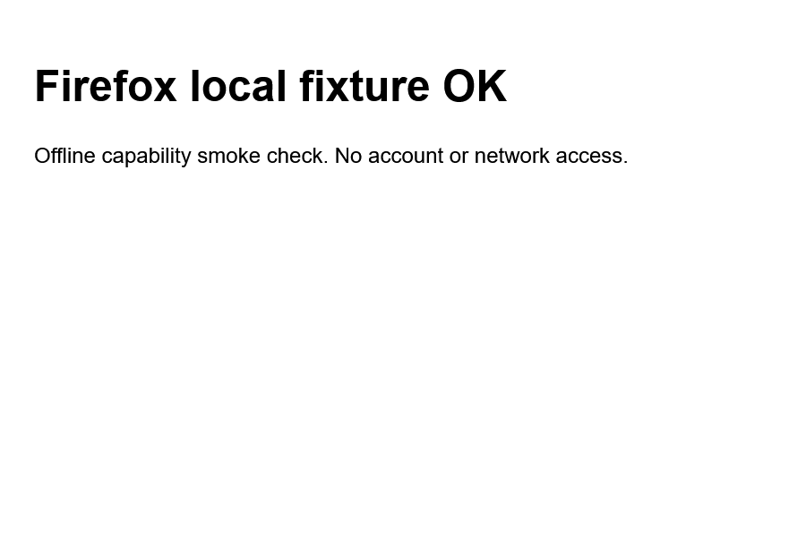

# 計畫審查與開發能力核查

核查日期：2026-10-02（Asia/Taipei）  
對象：ChatGPT 自製對話導航器，Firefox 第一優先  
修訂計畫：v1.2  
本次範圍：規格審查與環境能力檢查；未開發擴充功能

**後續狀態更新（2026-10-02）：使用者已恢復開發，Firefox v0.1原型已建置及原生合成自測；固定SHA的GPT-6.1 Sol high sub-agent獨立複驗進行中。最新計畫v1.4保留Git每功能／30分鐘commit、每次push與SHA核對。私人儲存庫：https://github.com/justamowei/chatgpt-toc-firefox 。真實ChatGPT長歷史與簽章仍PENDING；以下保留原次審查的環境證據，後續結果見原型驗收報告。**

## 結論

原 v1.1 足以啟動基礎原型，但不足以作為完整長對話版本的獨立驗收依據。主 agent 與 sub-agent 審查後，已將主要缺口補入 v1.2 第 12–14 節。

可承接 Firefox 原型、資料核心、介面、測試、打包與獨立程式審查。真實長對話的完整資料來源、遠距跳轉、分支與容器，以及正式簽章交付，必須依實際證據通過；目前未完成這些功能驗收。

## 已補的規格缺口

| 原缺口 | 修訂 |
|---|---|
| 實際登入頁面／樣本缺少時如何繼續 | T00／T01 gate；可先做核心與 fixture，但真實案例維持 PENDING |
| 完整度只核對首中尾，可能漏中間訊息 | 完整預期 ID 集合、順序、總數、分支與分頁邊界核對 |
| 分支未知時，已累積歷史可能繼續顯示 | 同 URL 編輯／重新生成也失效 epoch；撤銷舊歷史與錨點 |
| 遠距目標未固定，可能事後挑成功樣本 | 預先固定十個未掛載目標，10／10 正確才通過 |
| 取消、無進展、返回位置不夠明確 | token 失效、單批與總上限、三批無進展停止、fixture 返回誤差 ≤24 px |
| 權限撤回與停用清理不完整 | observer／timer／listener／UI／task teardown 與重複啟動案例 |
| 輸入安全無法直接驗收 | textContent、schema、大小上限、過期 epoch 與偽造 command 案例 |
| 沒有獨立驗收證據格式 | 固定案例 ID、build SHA-256、expected／actual、執行者與證據 |
| 原型與正式簽章混合 | T07a 原型／測試包；T07b 簽章與重啟／升版驗收 |
| Sub-agent 職責未具體規定 | 固定 build、唯讀來源審查、獨立測試、缺陷回報及修復後重跑 |

## 本機環境檢查

| 項目 | 結果 | 能證明／不能證明 |
|---|---|---|
| Node.js | 24.12.0，能執行 | 可用於開發與核心測試；尚無產品測試 |
| npm | 11.6.2，能執行 | 可查詢依賴來源；尚未完成安裝與鎖版 |
| Firefox | 本機安裝版本 157.0 | 已確認原生 Firefox 存在 |
| Firefox 本機頁面渲染 | PASS：900×600 截圖，15,216 bytes，已視覺檢查文字 | 本機 fixture 可渲染；不能證明擴充功能／登入聊天可操作 |
| web-ext | npm 來源中繼資料查詢成功，回傳 10.7.0 | 來源可取得；尚未安裝、lint 或載入任何擴充功能 |
| TypeScript／esbuild | 未確認有可直接使用的專案依賴 | 開發時在專案安裝並鎖版 |
| Playwright | 已提供套件，但對應 Firefox 執行檔不存在 | 不能直接當作完整 Firefox 自動化環境 |
| 真實 ChatGPT 長對話 | PENDING | 未取得測試設定檔內的登入狀態與固定樣本 |
| Mozilla 簽章 | PENDING | 未準備帳號授權，未提交套件 |

沙箱內的 Firefox 渲染第一次失敗，沒有截圖；經核准的沙箱外執行後生成截圖。npm 來源查詢在沙箱內遇到 EACCES，經核准執行並把暫存放在 work 後成功。沒有把失敗的嘗試列為成功，也沒有改動使用者既有 Firefox 設定檔。

Firefox 測試使用工作目錄內另建的獨立 profile，只開啟本機 HTML，未存取 ChatGPT 帳號。截圖如下：

截圖 SHA-256：`CDBEA1C46C7D7C6272135FAECE0AD9668BB3DD769C695E97F6E870553F06F60B`。

Playwright 官方說明其 Firefox 依賴修補版，不能直接控制品牌版 Firefox；原生 Firefox 驗收優先規劃 web-ext，互動驅動另外做能力探測。[官方瀏覽器文件](https://playwright.dev/docs/browsers#firefox)

## Sub-agent 審查狀態

第一輪：已完成唯讀規格審查，提出必要缺口，主 agent 已修訂。第二輪：sub-agent 判定 v1.2 規格可開工，另指出真實 ChatGPT 的取消／返回應獨立列為正式驗收案例；主 agent 已新增 LIVE-06／07 並修訂 release gate。另外補入測試專用 manifest 與實際載入附加元件的要求。

本次 sub-agent 審查是文件驗收，不能當作擴充功能或真實長對話驗收通過。

## 接續開發的判定

可以開始 T00、核心與原型工作。T01 真實頁面觀察仍需可用的測試登入與固定樣本；缺少時先完成不依賴帳號的工作，對 LIVE 案例保留 PENDING。

正式長對話版不能只靠畫面目錄或合成測試宣布完成；正式日常安裝版另需簽章後驗收。這些條件已寫入計畫，開發與 sub-agent 驗收均使用同一份判定標準。
